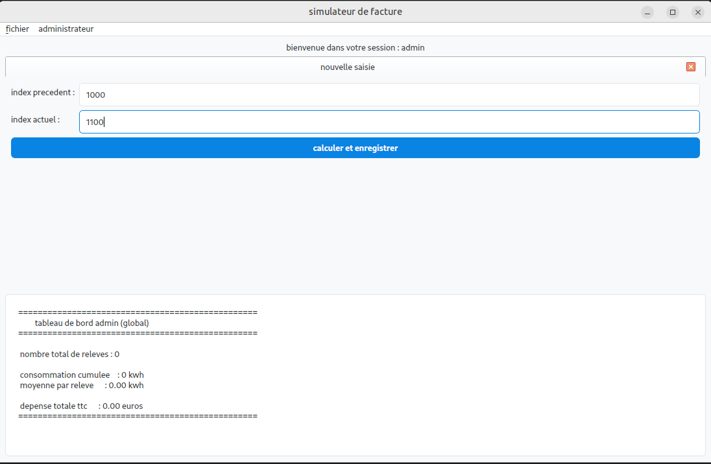
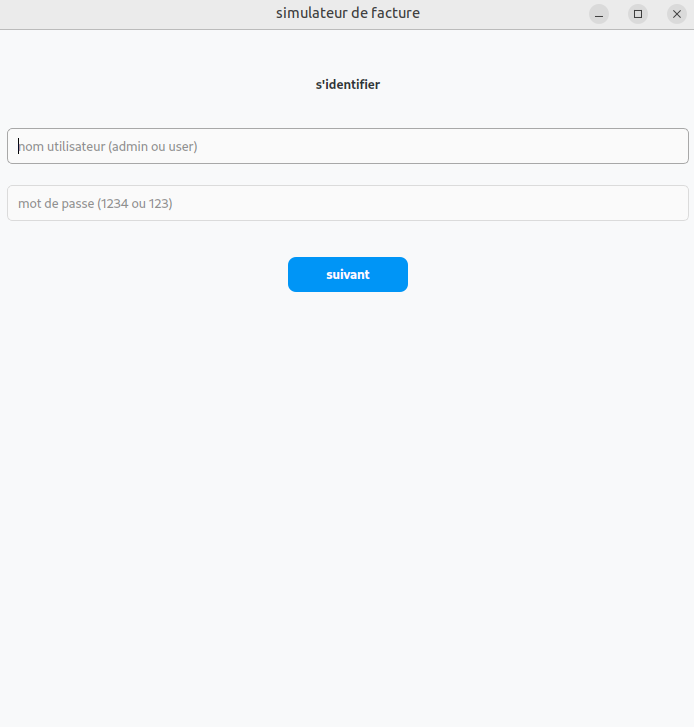
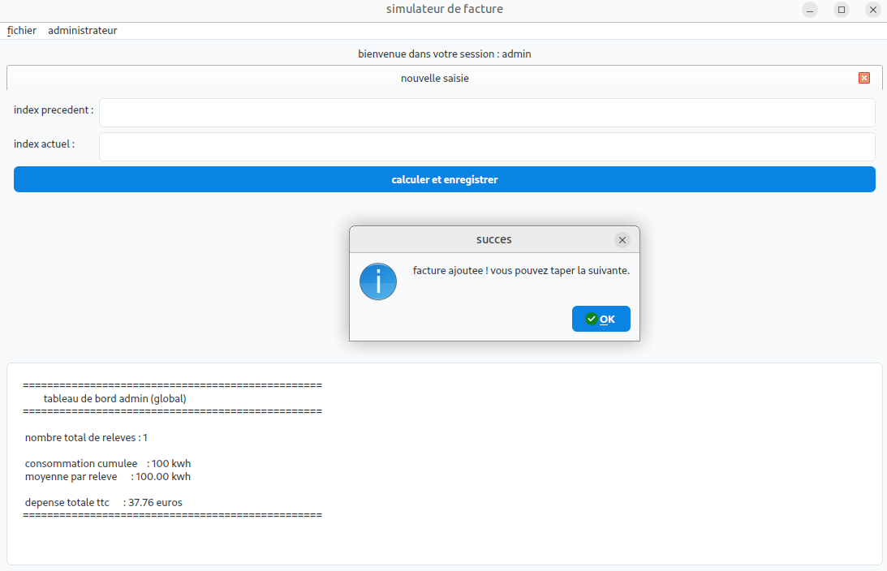

# Facture

Maquette d'application de facturation de gaz en C++ / Qt : à partir des relevés de
compteur, elle calcule la consommation et le montant TTC, avec un tableau de bord
par session et une session administrateur qui règle les tarifs.




## Contexte

SAE S2.05 du BUT Informatique (IUT d'Arles), mars-avril 2026. Application réalisée
par **Pierre Puget** ; la partie administrateur (réglage des tarifs) est de
**Julyan Klein**.

## Fonctionnalités

- **Connexion** avec deux profils : utilisateur ou administrateur
- **Saisie d'un relevé** (index précédent, index actuel) : la consommation en kWh
  et le montant TTC sont calculés aussitôt ; un index actuel plus petit que le
  précédent est refusé
- **Calcul** : consommation x prix du kWh + abonnement mensuel
  (0,2516 €/kWh et 12,60 €/mois par défaut)
- **Tableau de bord** : nombre de relevés, consommation cumulée, moyenne par relevé
  et dépense totale ; limité à la session pour un utilisateur, global pour
  l'administrateur
- **Administration** : modification du prix du kWh et de l'abonnement
- **Historique** : chaque relevé est ajouté au fichier `factures.txt`, et un
  fichier de facture texte peut être rouvert depuis le menu
- Interface en fenêtres multiples (MDI), déconnexion depuis le menu

| Connexion | Relevé enregistré |
|---|---|
|  |  |

## Lancer le projet

Prérequis : Qt (module Widgets) et Qt Creator.

1. Ouvrir `Facture.pro`, compiler puis lancer, avec le dossier du projet comme
   répertoire de travail (le logo et `factures.txt` sont en chemin relatif).
2. Se connecter avec un compte de démonstration : `admin` / `1234` ou
   `user` / `123`.

C'est une maquette : ces identifiants sont écrits en dur dans le code, il n'y a pas
de vraie authentification.

## Organisation du dépôt

```
Facture.pro          projet Qt
main.cpp
facture.*            un relevé : consommation, coût, montant TTC, tarifs partagés
mainwindow.*         écrans (connexion, saisie, tableau de bord, administration)
logo.png             logo de l'écran de connexion
docs/screenshots/    captures d'écran
```
